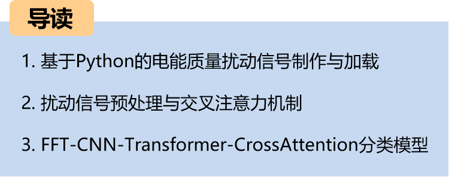
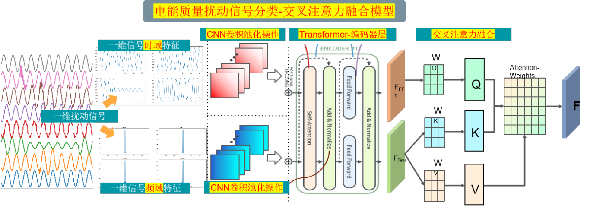
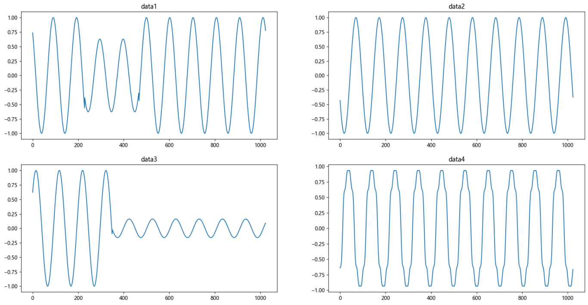
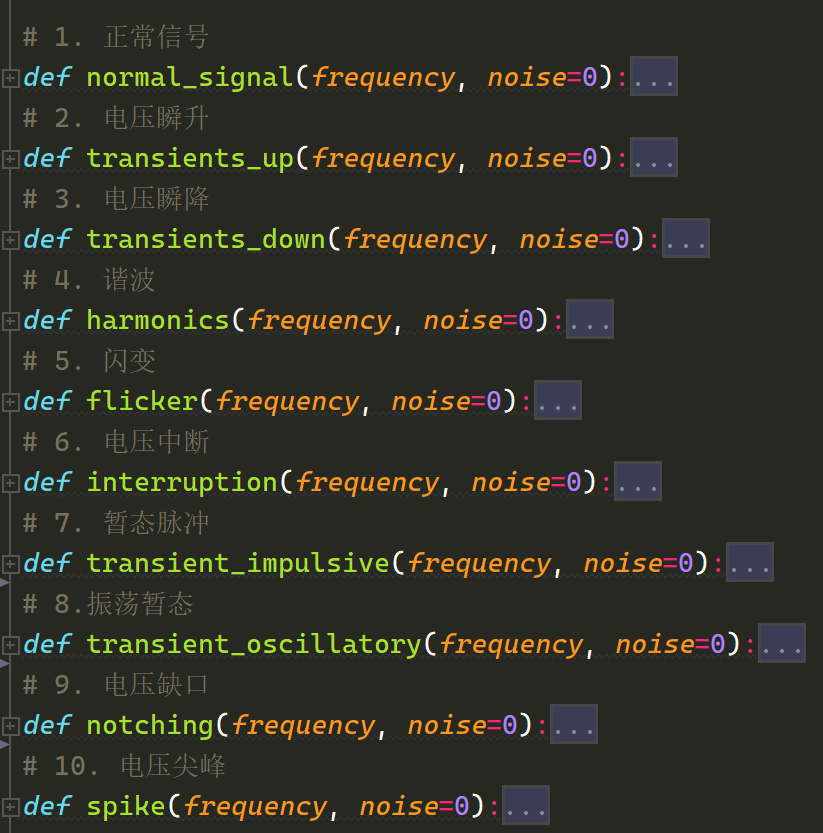
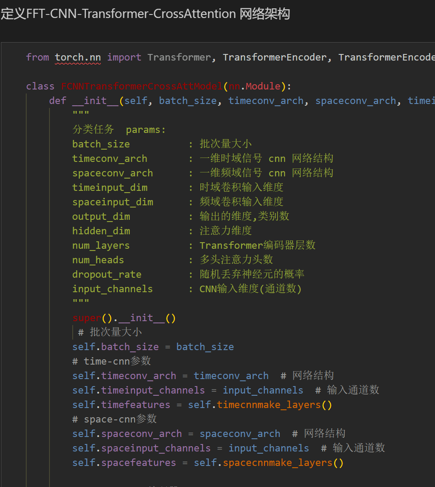
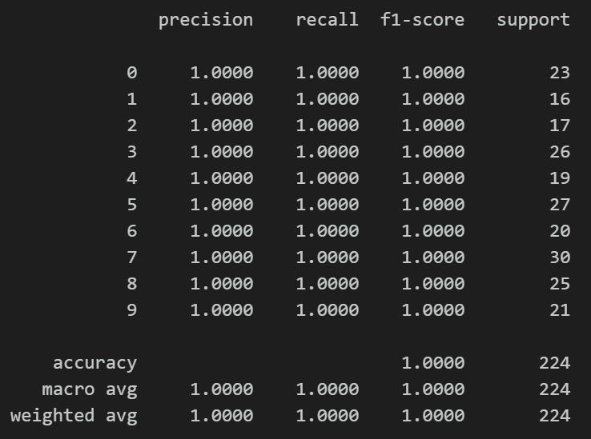
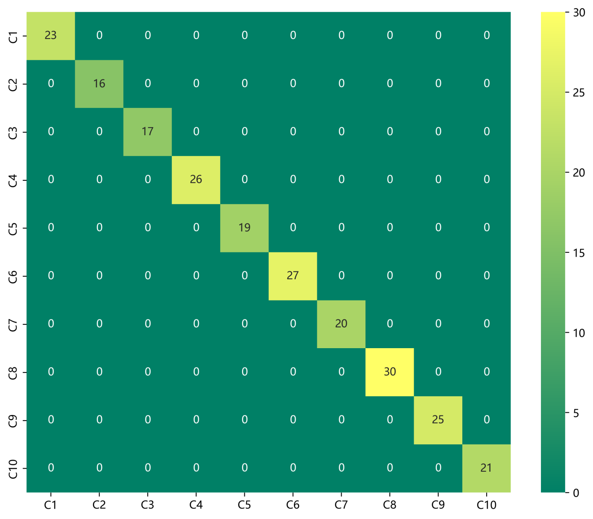
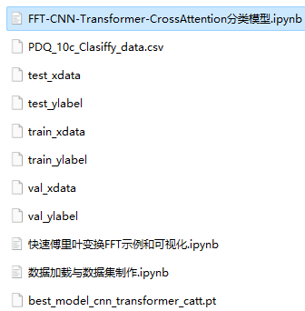

# Cross Attention Fusion of Time-Domain and Frequency-Domain Features with FFT + CNN -Transformer-CrossAttention for Power Quality Disturbance Identification

The family set includes the following content:
1. Thesis innovation!!!
2. The cross-attention mechanism can model the degree of correlation between different features, extracting important features for model recognition from disturbance signal frequency domain and time domain characteristics, with significant effects.
50 epochs, accuracy 100%, the FFT+CNN-Transformer-CrossAttention network achieves significant classification results, the model can fully extract spatial and temporal features as well as frequency domain features of the disturbed signals, with fast convergence speed and excellent performance, which is currently the highest accuracy method among previous articles. Innovation also exists!!!
Including a complete dataset of power quality disturbance signals, as well as already generated and prepared ten-class disturbance signal datasets, classification data sets, and label sets, corresponding codes can be run.
Including code for data preprocessing and the FFT+CNN-Transformer-CrossAttention classification model.
Environment: Python 3.9
Innovation point: Using the cross-attention mechanism to fuse time-frequency features!
Preface
This article introduces the FFT and data preprocessing for power quality disturbance signals based on Python simulation, and finally classifies the power quality disturbance signals through the implementation of the FFT-based CNN-Transformer-CrossAttention model in Python. For more detailed introduction of Python simulation power quality disturbance signals, please refer to the following text (Appendix 10-class dataset at the end):
Python-Power Quality Disturbance Signal Data Introduction and Classification
Some types of disturbance signal waveforms are shown below:
Overall structure of the model
The overall structure of the model is as follows: The one-dimensional perturbation signal undergoes FFT transformation to extract its frequency domain features, and the signal itself has its time domain features. These features are then processed through CNN convolutional pooling operations to extract global features. Subsequently, BiLSTM is used to extract sequential features. The cross attention mechanism is employed to fuse both time and frequency domain features. Through calculating attention weights, the model focuses more on important features for feature enhancement and fusion. Finally, the full connected layer and softmax output classification results.
Feature extraction in time and frequency domains:
Apply FFT to the time domain signal to convert it into the frequency domain.
Use CNN to learn and extract the frequency domain features. The convolutional layers of CNN can capture the local patterns of the frequency domain features.
Transformer encoder layer:
Input the time domain signal into the Transformer encoder layer. The Transformer encoder layer can effectively capture the long-term dependencies of the time domain signal.
Cross attention mechanism:
Use the cross attention mechanism to fuse the time and frequency domain features. This can be achieved by calculating attention weights so that the model pays more attention to important features.
Fast Fourier Transform (FFT) principle introduction:
Fourier transform is a tool for signal processing and spectral analysis, which converts a signal from the time domain to the frequency domain. The Fast Fourier Transform (FFT) is an efficient algorithm for implementing the Fourier transform, especially suitable for the processing of discrete signals.
First step, import part of the data, visualize perturbation signals:
Second step, visualize perturbation signals after FFT:
Preprocessing of power quality disturbance data:
2.1 Import data:
Based on the reference IEEE Std1159-2019 power quality detection standard and relevant literature, a model for perturbation signals was constructed, generating 10 types of single signals and various composite disturbance signals. Following previous articles, preprocessing of 10-classification of perturbation signals was carried out:
First step, generate single signals according to the formula model.
\t  
Single disturbance signal visualization:
2.2 Dataset Production
\tCreating dataset and classification labels
3 Cross Attention Mechanism
\t3.1 Cross Attention Concept
\tThe two sequences must have the same dimensions.
\tThe two sequences can be different patterns (such as: text, sound, image).
A sequence as input defines the output sequence length, and another sequence provides the input K&V.
3.2 Cross-attention Algorithm
\tCalculate K and V for S1.
Calculate Q for S2
\tCalculate the Attention Matrix Based on K and Q
\tApply V to the Attention Matrix
The output sequence length is consistent with S2.
During the fusion process, we use the frequency domain features transformed by FFT as query sequences and temporal features as key-value pairs. By calculating the attention weights between the query sequences and the key-value pairs, we can model the degree of association between different features.
4. FFT+CNN-Transformer-CrossAttention Disturbance Signal Recognition Model
4.1 Network Definition Model
\tNote: The input fault signal data shape is [64, 1024], batch_size=64, where 1024 represents the length of perturbation signal sequence.
4.2 Set parameters and train the model
50 epochs, with an accuracy of 100%. The FFT+CNN-Transformer-CrossAttention integrated network model significantly improves classification performance. The model is capable of fully extracting spatial and temporal features as well as frequency domain features from bearing fault signals. It converges quickly, has superior performance, high accuracy, and the cross attention mechanism can model the degree of association between different features. It effectively extracts important features from the frequency and time domain characteristics of fault signals, resulting in significant improvements.
4.3 Model Evaluation
Accuracy, Precision, Recall, F1 Score
Fault Classification Confusion Matrix:
Previously Interesting Content:
Introduction to Python-based Power Quality Disturbance Signal Data and Classification
Classification of One-Dimensional Signals Based on LSTM Model for Python-based Power Quality Disturbance Signal Classification
Classification of One-Dimensional Signals Based on CNN Model for Python-based Power Quality Disturbance Signal Classification
Classification of One-Dimensional Signals Based on Transformer for Python-based Power Quality Disturbance Signal Classification Model
Classification of One-Dimensional Signals Based on CNN-BiLSTM for Python-based Power Quality Disturbance Signal Classification Model
Classification of One-Dimensional Signals Based on CNN-Transformer for Python-based Power Quality Disturbance Signal Classification Model
Power Quality Disturbance Identification Model with FFT + CNN - BiGRU-Attention Attention Fusion of Time and Frequency Features

## Images

<!-- PAYMENT_BLOCK -->

## Get this dataset

- Payment link (Stripe): [Buy now](https://buy.stripe.com/3cs8yP7sY87d0vu9AB)
- Payment QR code: 

<!-- /PAYMENT_BLOCK -->
